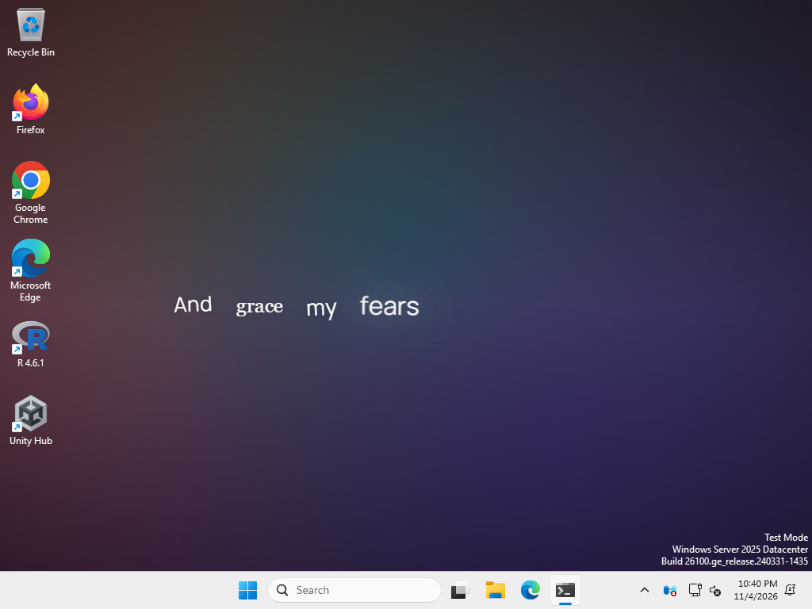

# Lunalyr for Windows

**Animated, word-timed lyric wallpapers for Windows** — a port of [Lunalyr](https://github.com/WaterBotol/Lunalyr) for macOS.

Lunalyr sits in the notification area, follows the song that is playing in any app that uses Windows media controls (Spotify, Apple Music for Windows, browsers and more), finds synced lyrics and draws them behind your desktop icons on every monitor, word by word, over a gradient taken from the album art.

> Status: early port. See [PORTING.md](PORTING.md) for the architecture and what is reused from macOS, and [VALIDATION.md](VALIDATION.md) for what has been verified and how.



*Captured by the CI smoke test on GitHub's Windows Server 2025 (24H2) runner: a media session reports "Amazing Grace" (public-domain words), Lunalyr finds word-timed lyrics and draws them behind the desktop icons.*

## Features

- **Now playing** from Windows' Global System Media Transport Controls: Spotify, Apple Music for Windows, browsers and anything else that shows up in the Windows media flyout. No app-specific setup or permissions.
- **Lyrics** from LRCLIB, NetEase Cloud Music, Lyrics+/KPoe, QQ Music, Kugou, Kuwo, lyrics.ovh and a folder of your own LRC/TTML/YRC files, chosen with the macOS app's "Accuracy first" rules (real word timing first, then title/artist/duration confidence, then your source order). Saved choices, LRC/TTML import and per-song offsets.
- **A wallpaper behind the desktop icons** on every monitor, on Windows 10 and Windows 11 including the 24H2 desktop changes. It pauses while a full-screen or maximised app covers a monitor, while the PC is locked and while the displays are off.
- **All eight lyric compositions** from macOS — Editorial, Spoken, Scattered, Constellation, Constellation + Editorial, Echo, Cascade and Cutout — with word-timed reveals, next-word previews and instrumental-interlude cues, over an animated album-colour gradient.
- **Visualisers** driven by the sound playing on the PC (WASAPI loopback): a calm built-in spectrum and the bundled Wavefield engine.
- **Readings**: Japanese (using Windows' own phonetic analyser), Mandarin pinyin with or without tone marks, Korean Revised Romanization — shown below the lyrics or in place of them.
- Tray menu, settings window, launch at login, settings saved under `%APPDATA%`.

## Install

Download `Lunalyr_0.1.0_x64-setup.exe` from the [latest preview release](https://github.com/WaterBotol/Lunalyr-Windows/releases/tag/v0.1.0-preview.1) and run it (each CI run's artifacts also contain a fresh build). It installs per user (no administrator rights) and uses the Microsoft Edge WebView2 runtime, which Windows 10/11 normally already has; the installer fetches it if not. The app is not code-signed yet, so SmartScreen may ask you to confirm.

## Develop

The renderer and most logic can be developed on any OS; only the Windows platform layer needs Windows (or CI).

Requirements: Rust (stable), Node 22+, and for Windows-target checks from macOS, LLVM (`brew install llvm`, for `llvm-rc`).

```bash
npm ci
npm test                      # renderer unit tests (vitest)
cargo test --workspace        # lyric core, controller and platform helpers
npx vite                      # then open http://localhost:5173/demo.html
npm run tauri dev             # the whole app; on macOS with a stand-in platform layer
```

Check the Windows build from macOS:

```bash
PATH="/opt/homebrew/opt/llvm/bin:$PATH" cargo check -p lunalyr --target x86_64-pc-windows-msvc
```

On Windows, `npm run tauri build -- --bundles nsis` builds the app and its installer. The [Windows workflow](.github/workflows/windows.yml) runs all tests, builds the installer and smoke-tests it on a `windows-latest` desktop (screenshot and window tree are uploaded as artifacts).

The demo page takes query parameters for reproducible screenshots, e.g. `demo.html?state=synced&composition=spoken&t=12.5&paused=1&controls=0`.

## Layout

| Path | What |
|---|---|
| `crates/lunalyr-core` | Lyric model, parsing, ranking, providers, cache, palette, settings (no OS dependencies) |
| `src-tauri` | Tauri app: controller, wallpaper windows, tray, commands; `platform/windows` (GSMTC, WorkerW, WASAPI) and `platform/dev.rs` (stand-in for other OSes) |
| `ui` | TypeScript renderer (`wallpaper.html`), settings window, `demo.html` harness |
| `docs/CONTRACT.md` | Events and commands between Rust and the webviews |
| `scripts/` | CI smoke test |

## Privacy

Song title, artist, album and duration are sent to the enabled lyric providers. Audio analysis (Milestone 2) stays in memory and is never recorded or uploaded.

## Licence and attribution

Based on Lunalyr for macOS, itself based on [Verso](https://github.com/AkkiCode06/verso) by Akki / AkkiCode06. Verso's GPLv3 licence with the Commons Clause condition is retained unchanged in [LICENSE](LICENSE); upstream details are in [UPSTREAM.json](UPSTREAM.json). Third-party components and their licences are listed in [THIRD_PARTY_NOTICES.md](THIRD_PARTY_NOTICES.md).
